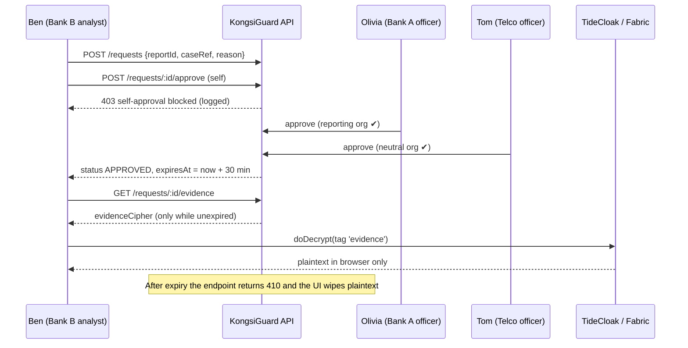
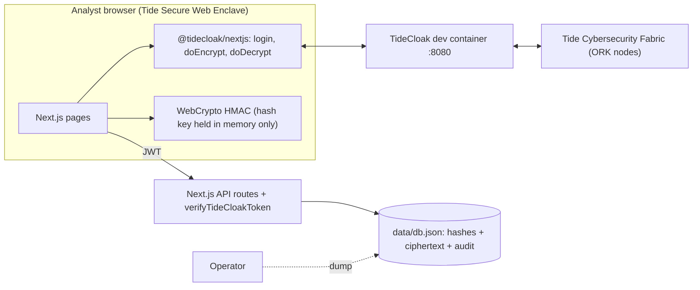

# MVP Spec: **KongsiGuard**: a mule-account signal exchange the operator can't see into

> Working name. *Kongsi* is Malay for "share". Swap it for your team's choice.
> Challenge: **RMIT Hackathon 2026, Challenge 2 "UNLOCKED"**, built on TideCloak.
> Source idea: `idea1.pdf` (RMIT_Claude). Rules are from `tide.org/unlocked` and the briefing slides.

> [!IMPORTANT]
> **Deadline: Malaysia, Thu 22 Oct, 6:00 pm.** That leaves about **3h 30m** from 2:30 pm. This spec is cut to fit that time. Build the **Must** tier first, keep a backup video, and **label every simulated part** (judges check for this explicitly).

---

## 1. One-liner

Competing banks, telcos and e-wallets share mule-account warnings within minutes. No platform operator, vendor or rival can read the evidence, widen access or approve itself, because authority over the data **emerges only when identity, roles and a cross-organisation quorum line up** (TideCloak Emergent Authority).

## 2. Problem and trust constraint (judging: *Trust constraint insight*, 20%)

| | |
|---|---|
| **Real problem** | Scam proceeds move through *mule* accounts. Malaysia's NSRC handled **66,997 calls** in 2023 and disrupted **59,684 suspected mule accounts** (BNM 2023 annual report, reported Mar 2024). |
| **Existing effort** | BNM + PayNet run the **National Fraud Portal** (Aug 2024). We **complement** it and don't replace it. We are *not* claiming the problem is unaddressed, or that telcos/e-wallets are left out. |
| **Privacy / law** | FSA 2013 s.133 imposes bank secrecy. Disclosure is allowed only in narrow cases, such as suspected offences or enforcement. *(Have the lecturer verify this.)* |
| **Custody** | Whoever pools all reports becomes the single biggest breach target. |
| **Authority** | Whoever runs the pool can quietly widen who sees what. |
| **Trust** | Rival institutions won't hand raw data to a competitor or a vendor. |

**What becomes possible:** a sharing network where the **operator is blind**, **disclosure is policy-gated** and **membership is member-governed**. Rivals and smaller players such as e-wallets can join without trusting anyone with everything.

## 3. Users and synthetic organisations

> [!CAUTION]
> **Synthetic data only.** Never use real account numbers, names or evidence.

| Persona (Tide account) | Org | App role | QEA admin? | Demo purpose |
|---|---|---|---|---|
| `alice` | Bank A | analyst | – | Files the mule report |
| `olivia` | Bank A | officer | ✅ | Approves tier-2 as the reporting org |
| `ben` | Bank B | analyst | – | Checks the account, requests evidence |
| `tom` | Telco | officer | ✅ | Neutral approver (neither A nor B) |
| `eve` | E-wallet | *(none yet)* | – | Admitted live by a governance vote |
| `operator` | Platform host | realm admin | ✅ | "Breach theatre" villain |

With 3 QEA admins, TideCloak's quorum is `max(1, floor(3 × 0.7)) = 2`, so **the operator alone can never commit a change**.

## 4. Scope by build tier

| Tier | Feature | TideCloak used | Real or simulated |
|---|---|---|---|
| **MUST** | M1 BYOiD login (no password DB) | `@tidecloak/nextjs` login, `<Authenticated>` | Real |
| **MUST** | M2 File encrypted mule report | `doEncrypt` tags `tier1`, `evidence` | Real |
| **MUST** | M3 Tier-1 lookup (hit + reason + reporting org) | keyed hash, key decrypted via `doDecrypt` tag `hashkey` | Real |
| **MUST** | M4 Operator DB dump shows only ciphertext/hashes | the operator holds no keys | Real |
| **MUST** | M5 Server rejects forged/unauth API calls | `verifyTideCloakToken` + middleware | Real |
| **SHOULD** | S1 Tier-2 disclosure: request, 2 approvals from distinct orgs, no self-approval, 30-min expiry | `doDecrypt` tag `evidence` after app gate | **App-layer gate (simulated Forseti)** |
| **SHOULD** | S2 Audit page (lookups, requests, approvals, votes) | – | App log, hash-chained |
| **SHOULD** | S3 Operator tries to grant itself a role and gets stuck at 1/2 | **QEA change request** in tide-console | Real |
| **COULD** | C1 Live vote admits e-wallet | **QEA change request** (2-of-3 admins) | Real (via tide-console) |
| **ROADMAP** | Forseti contract (`ForbidSelfApproval`, `RequireDistinctOrgs`, time-lock) enforcing tier-2 in the Fabric; Private Set Intersection for matching | – | Not built |

## 5. Core flows

### M2 Report (Bank A analyst)
1. Alice enters: **identifier type** (`BANK` / `PHONE` / `EWALLET`), **identifier**, **reason code**, **evidence** (free text).
2. Browser normalises the ID (`TYPE:` + uppercase, digits/letters only) and computes `acctHash = HMAC-SHA256(hashKey, normalisedId)` with WebCrypto.
3. Browser calls `doEncrypt([{data: JSON{reason,org,date}, tags:['tier1']}, {data: evidence, tags:['evidence']}])`.
4. `POST /api/reports` sends `{acctHash, tier1Cipher, evidenceCipher, reportingOrg}`. **Plaintext ID and evidence never leave the browser.**

### M3 Check / tier 1 (Bank B analyst)
1. Ben types the identifier. The browser computes the same HMAC and calls `GET /api/check?h=<acctHash>`.
2. Server returns matching `{reportId, reportingOrg, tier1Cipher, createdAt}`. **No evidence.**
3. Browser `doDecrypt`s `tier1` and shows **"⚠ HIT: R02 Rapid pass-through, reported by Bank A, 22 Oct"**.

### S1 Disclose / tier 2

**Approval rules (server-enforced):** approver ≠ requester · approver org ≠ requester org · one approver **must** be from the reporting org · one **must** be from a third org · role `officer` required · default 30 min, **90 s for the demo** (env `DISCLOSURE_TTL_SECONDS`).

### S3 / C1 Governance (real TideCloak QEA)
- **Operator self-grant:** the operator assigns itself `_tide_evidence.selfdecrypt` in tide-console. A change request is created at **1/2 approvals** and is *not committed*. Show the QEA Approvals inbox.
- **Admit e-wallet:** assign `org-ewallet` + `analyst` to `eve`. Olivia and Tom each **Authorize** in QEA Approvals, the request commits at quorum, and Eve logs in and can now run checks.
- The in-app `/governance` page lists members (from token roles) and links to tide-console QEA Approvals. **We don't build our own voting engine.**

## 6. TideCloak configuration

**Realm roles** (each one is a QEA change request, so create them all **while there is only 1 admin**, which keeps the threshold at 1):

| Role | Assigned to |
|---|---|
| `org-bank-a`, `org-bank-b`, `org-telco`, `org-ewallet` | one per user |
| `analyst`, `officer` | per persona |
| `_tide_tier1.selfencrypt` / `.selfdecrypt` | all analysts + officers |
| `_tide_evidence.selfencrypt` | analysts |
| `_tide_evidence.selfdecrypt` | analysts *(the server gates release of the ciphertext; see §9)* |
| `_tide_hashkey.selfencrypt` / `.selfdecrypt` | all members (the encrypt role only for the bootstrap officer) |

**Order of operations:** create roles → create users → assign roles → verify the app works → **then** add `olivia` + `tom` as `tide-realm-admin` (quorum becomes 2). The governance demo only works after this step.

## 7. Architecture



**Stack:** template from `npm init @tidecloak/nextjs@latest`, Next.js API routes, **JSON file store** (`data/db.json`, so no native SQLite builds on Windows). Tailwind or the template's styling. Docker Desktop is needed for TideCloak.

### Data model (`data/db.json`)
```ts
config:    { encHashKey: string }                       // doEncrypt(tag 'hashkey')
reports:   { id, acctHash, reportingOrg, reporterSub, tier1Cipher, evidenceCipher, createdAt }
requests:  { id, reportId, requesterSub, requesterOrg, caseRef, justification,
             approvals: [{ sub, org, at }], status: 'PENDING'|'APPROVED'|'EXPIRED', expiresAt }
audit:     { seq, at, actorSub, actorOrg, action, target, prevHash, hash }  // hash-chained
```

### API (every route except `/api/operator/dump` runs `verifyTideCloakToken(config, token, roles)`)
| Method | Route | Roles | Notes |
|---|---|---|---|
| GET / POST | `/api/hashkey` | member / officer | POST once (bootstrap): browser generates 32 random bytes and `doEncrypt`s them |
| POST | `/api/reports` | analyst | stores hash + ciphertexts |
| GET | `/api/check?h=` | analyst | returns tier-1 cipher only, logs `LOOKUP` |
| POST | `/api/requests` | analyst | logs `REQUEST` |
| POST | `/api/requests/:id/approve` | officer | rules in §5, logs `APPROVE` / `APPROVE_DENIED` |
| GET | `/api/requests/:id/evidence` | requester only | 403 if not approved, 410 if expired |
| GET | `/api/audit` | member | full log + chain-valid flag |
| GET | `/api/operator/dump` | none (simulates DB theft) | raw `db.json` |

### Pages
`/` login · `/report` · `/check` · `/requests` (inbox + approve + countdown evidence viewer) · `/audit` · `/governance` · `/operator` (red "breach theatre" page with the raw dump and a "try to decrypt" button that fails without a session)

## 8. Why TideCloak matters (judging: 20%)

| Need | TideCloak feature | With a normal IdP + DB key… |
|---|---|---|
| No password DB to steal | **BYOiD** login | the IdP stores password hashes |
| Evidence and hash key unreadable to the host | **`doEncrypt`/`doDecrypt`** with tag roles, keys held by the Fabric (ineffable) | **the operator holds the key, so the "DB dump" moment fails** |
| No admin quietly grants themselves access | **QEA**: role changes need 2-of-3 admins | the admin clicks "grant" and it's done |
| Forged requests rejected | `verifyTideCloakToken` / middleware on Fabric-signed tokens | the server can mint its own tokens |
| Tier-2 with distinct orgs and expiry | *(roadmap)* **Forseti** M-of-N, `ForbidSelfApproval`, time-locks | app logic the admin can patch out |

> **Swap test (say it in the video):** "Replace TideCloak with Auth0 + an AES key in `.env`, and the operator who dumps the DB also has the key. Our demo would fail. That's why TideCloak is central."

## 9. Honest limits and simulated parts (put this in the README)

> [!WARNING]
> - **Tier-2 gating is app-layer.** The server withholds evidence ciphertext until approvals pass. Analysts hold `_tide_evidence.selfdecrypt`, so a rogue operator **colluding with a member analyst** could skip approvals. They still **cannot decrypt anything alone**. *Roadmap:* move the rules into a Forseti contract so the Fabric itself refuses.
> - **Expiry** = the server stops serving the ciphertext and the UI wipes the plaintext. Plaintext a user already saw can't be "un-seen".
> - **Keyed-hash matching:** a member insider with the hash key could brute-force low-entropy account numbers. *Roadmap:* Private Set Intersection.
> - **Governance** runs through the TideCloak tide-console (no app-facing change-request API was confirmed).
> - **Synthetic** orgs, accounts and evidence. No integration with the National Fraud Portal, PayNet or real banks.
> - TideCloak is in active development and depends on the Tide Fabric, so a **backup video is recorded**.

## 10. Verify in the first 30 minutes (stop and re-plan if any fail)

1. **Cross-user decrypt.** User A runs `doEncrypt` with tag `tier1` and user B (who holds `_tide_tier1.selfdecrypt`) runs `doDecrypt`. The docs say data is sealed with a realm-level *Ineffable Key* and gated by token roles, so this *should* work. *If it fails:* ask Tide's **Raziel MCP** / Discord `#support` straight away, because the whole design depends on it.
2. **Role assignment flow:** a role assignment shows up in QEA Approvals and commits with 1 admin.
3. **Multi-admin quorum:** after adding 2 admins, a single Authorize leaves a request pending.

## 11. Two-minute demo video (required: `.mp4`, under 100 MB)

| Time | Beat | On screen |
|---|---|---|
| 0:00–0:15 | **Possibility + problem** | "59,684 mule accounts disrupted in 2023. Sharing helps, but whoever runs the pool sees everything." |
| 0:15–0:40 | **Report + check** | Alice files a report. Ben types the account and gets a ⚠ HIT with reason + Bank A, *no evidence*. |
| 0:40–1:10 | **Tier-2** | Ben requests, his self-approve is **blocked**, Olivia + Tom approve, the evidence decrypts, and the 90 s countdown expires to **410**. |
| 1:10–1:35 | **Breach theatre** | `/operator` dump shows only hashes + ciphertext. Operator self-grants in tide-console: **stuck at 1/2**. |
| 1:35–1:50 | **Governance** | Olivia + Tom authorize, the e-wallet is admitted, and Eve runs a check. |
| 1:50–2:00 | **What changes + honesty** | Audit page. "Simulated: tier-2 gate is app-layer; Forseti is the roadmap." |

## 12. Compressed timeline (today)

| Time | Track A (infra/TideCloak) | Track B (app) | Track C (story) |
|---|---|---|---|
| 14:30–15:00 | Docker + `tidecloak-dev`, `npm init @tidecloak/nextjs`, enrol, roles, users. **Run §10 checks** | Scaffold pages, db.json helper, audit chain | README overview draft, summary.doc |
| 15:00–16:15 | Assign roles, test personas in separate browser profiles | **M2–M5** (report, check, operator dump, token checks) | Demo script, slide stats |
| 16:15–17:00 | Add 2 QEA admins, rehearse S3/C1 | **S1 + S2** (tier-2, audit) | Record a **backup** run of the Must features |
| 17:00–17:30 | Freeze code | Bug fixes, polish | **Record final 2-min video** |
| 17:30–17:50 | `sourcecodes.zip`, push, make the repo public | Run instructions | README, check every link |
| **≤ 17:55** | **Submit Google Form** `forms.gle/HRHYjnqB86j1LFS97` | | |

> [!TIP]
> Use **separate Chrome profiles** (or one normal window plus one Incognito per persona) so 4 or 5 Tide sessions can run side by side for the demo.

## 13. Submission checklist

- [ ] Public repo named **`<university>_<campus>_<team>_C2`**
- [ ] `README.md` starts with the **Project overview** (≤300 words, 5 prompts) followed by a separate **Setup / Run instructions** section
- [ ] `video.mp4` (2 min, under 100 MB)
- [ ] `summary.doc` (problem, solution, value, role of TideCloak)
- [ ] `sourcecodes.zip`
- [ ] Simulated/mocked parts listed clearly (§9)
- [ ] Google Form submitted

---

## Appendix A: README project overview draft (≈270 words)

> **KongsiGuard** lets rival banks, telcos and e-wallets share mule-account warnings without any operator, vendor or rival being able to read the evidence or change the rules alone.
>
> **1. What are we proposing?** An operator-blind, member-governed mule-signal exchange that complements BNM's National Fraud Portal. Members check an account and see a hit instantly. Full evidence opens only with approval from the reporting org and a neutral org, and only for a limited time.
>
> **2. What trust constraint does it remove?** Bank secrecy (FSA 2013 s.133) and competition make institutions reluctant to pool data. Whoever hosts the pool becomes the biggest breach target and can quietly widen access. With no single holder of the keys or the rules, sharing becomes acceptable.
>
> **3. Who benefits?** Fraud analysts stop mule cash-outs within minutes. Smaller players such as e-wallets join without trusting a rival. Scam victims get money frozen sooner (NSRC disrupted 59,684 mule accounts in 2023).
>
> **4. How does TideCloak enable it?** BYOiD login (no password DB). `doEncrypt`/`doDecrypt` keep evidence and the matching key unreadable to our server. Quorum-Enforced Authorization means no admin can grant themselves access or admit a member alone. `verifyTideCloakToken` rejects forged calls. With a normal IdP and a server key, the operator could decrypt everything.
>
> **5. What does the prototype show?** Report, then tier-1 hit, then a blocked self-approval and cross-org tier-2 release that expires. Then an operator DB dump that shows only ciphertext, a stalled operator self-grant, and a live quorum admitting an e-wallet. *Simulated:* synthetic data, tier-2 gating is app-layer (Forseti is the roadmap), and there is no real Fraud Portal link.

## Appendix B: Starter prompt for your coding agent (with Tide's Raziel MCP)

```text
Using the TideCloak Next.js template in this repo, build "KongsiGuard" per mvp_spec.md:
- Pages: /report, /check, /requests, /audit, /governance, /operator.
- Store data in data/db.json (reports, requests, audit hash-chain, config.encHashKey).
- In the browser: normalise identifier, HMAC-SHA256 with a hash key decrypted via
  doDecrypt tag 'hashkey'; encrypt tier-1 JSON with tag 'tier1' and evidence with tag 'evidence'.
- All API routes verify the bearer token with verifyTideCloakToken and role checks
  (org-* roles, analyst, officer). /api/operator/dump returns raw db.json without auth.
- Tier-2 approval rules: no self-approval, approver org != requester org, needs one
  reporting-org officer + one third-org officer; TTL from DISCLOSURE_TTL_SECONDS; 410 after expiry.
- Log every lookup/request/approval/denial to the audit chain.
```
